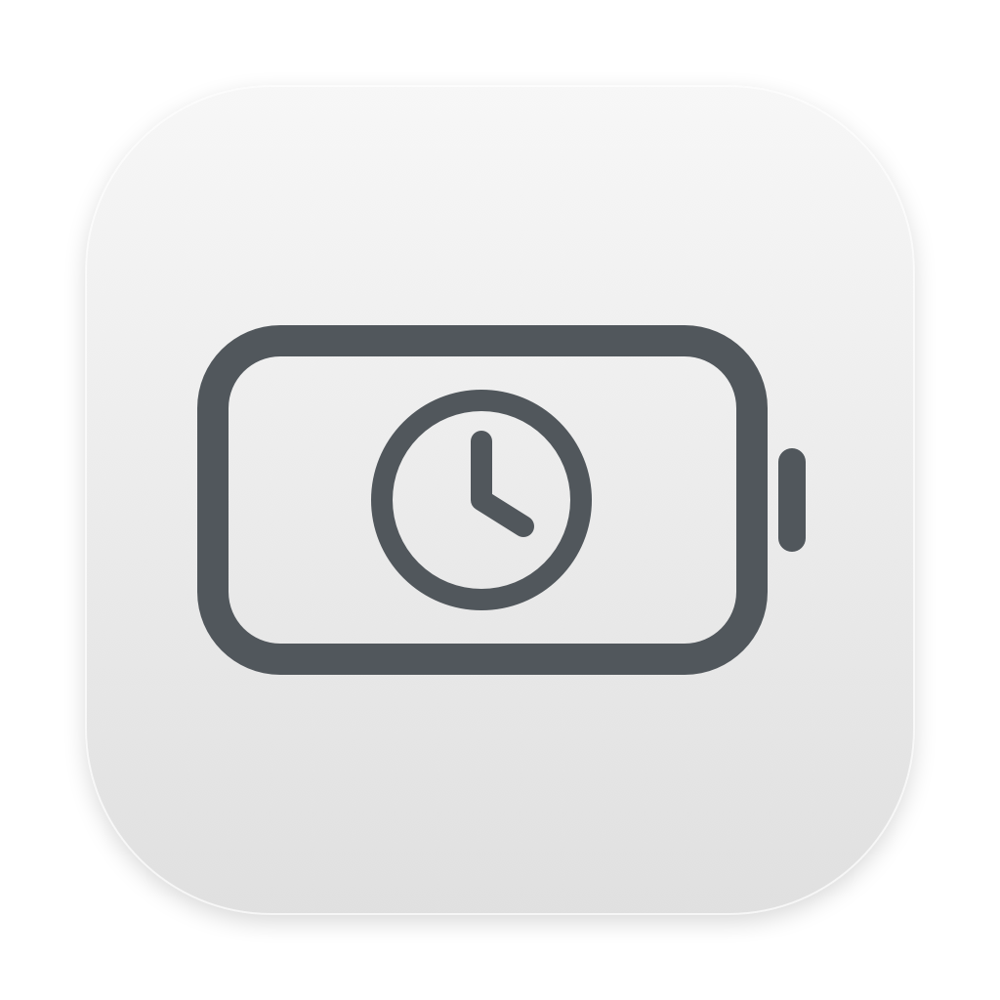

<p align="center">
  
</p>

# Battery Time

A small, native macOS menu bar app that keeps your battery's remaining time in view.

[简体中文](README.zh-CN.md) · [Download](https://github.com/ygyleo/mac-battery-remaining-time/releases/latest)

## What it does

- Shows a filled, rounded battery icon with the current charge level, including while connected to power. On battery power, it is neutral normally, yellow at 20% or less, and red at 10% or less.
- Shows a lightning bolt while charging and a plug when connected without charging.
- Opens a compact native menu with only two readings: battery charge and remaining time. There are no Settings or Quit buttons in this menu.
- Has three settings: Chinese / English, show time in the menu bar, and launch at login. Time is shown by default; launch at login is off by default.

**Requirements:** an Apple Silicon Mac (M series), macOS 13 Ventura or later. Intel Macs are not supported. Macs without an internal battery show an unavailable state.

## Install

1. Download `Battery-Time-1.1.0-arm64.dmg` from [Releases](https://github.com/ygyleo/mac-battery-remaining-time/releases).
2. Open the disk image and drag **Battery Time** into **Applications**.
3. Launch it from Applications, Finder, or Spotlight to open Settings. Closing Settings keeps Battery Time running in the menu bar and removes its Dock icon.

To change settings later, search for **Battery Time** in Spotlight and open it again. To quit the app, open Settings and use **Battery Time → Quit Battery Time** or **⌘Q**. Login launches stay quietly in the menu bar without opening Settings.

To update an older version, quit it first, then replace **Battery Time.app** in Applications with the copy from the new DMG. Your preferences are retained.

The current release is ad hoc signed and **not notarized by Apple**. If macOS blocks the first launch, open **System Settings → Privacy & Security**, find Battery Time's blocked-launch message, and choose **Open Anyway** if you trust the downloaded app. You can also build it yourself from source.

## Reading the estimate

The estimate comes from macOS and changes with your workload. It can be unavailable or show “Estimating…” briefly after startup, waking from sleep, or disconnecting the charger. The app does not invent a time when the system has no estimate.

While charging, the time refers to **time until full**. When fully charged or connected to power without charging, the app shows that state instead. Hiding the time in the menu bar leaves the battery icon visible; clicking it still shows both readings. Language and time-visibility changes apply immediately and are remembered. macOS may ask you to approve launch at login in Login Items.

## Build from source

Install Xcode and [XcodeGen](https://github.com/yonaskolb/XcodeGen), then run:

```sh
git clone https://github.com/ygyleo/mac-battery-remaining-time.git
cd mac-battery-remaining-time
swift test --scratch-path build/swift-tests
bash scripts/build-release.sh
bash scripts/package-dmg.sh 1.1.0
```

The application and disk image are written to `dist/`. `SHA256SUMS.txt` contains the release checksum. To work in Xcode, run `xcodegen generate` and open `BatteryTime.xcodeproj`.

The build targets `arm64` and uses only Apple frameworks: AppKit, SwiftUI, IOKit, and ServiceManagement. There are no third-party runtime dependencies. The release scripts produce an ad hoc signature; Developer ID signing and notarization require your own Apple Developer credentials and a separate signing/notarization step.

## Privacy

Battery Time reads local battery information. The application makes no network requests, collects no analytics, and needs no API key. It stores the selected language and whether to show time in the menu bar; launch at login is managed by macOS.

## License

[MIT](LICENSE) © 2026 ygyleo.
