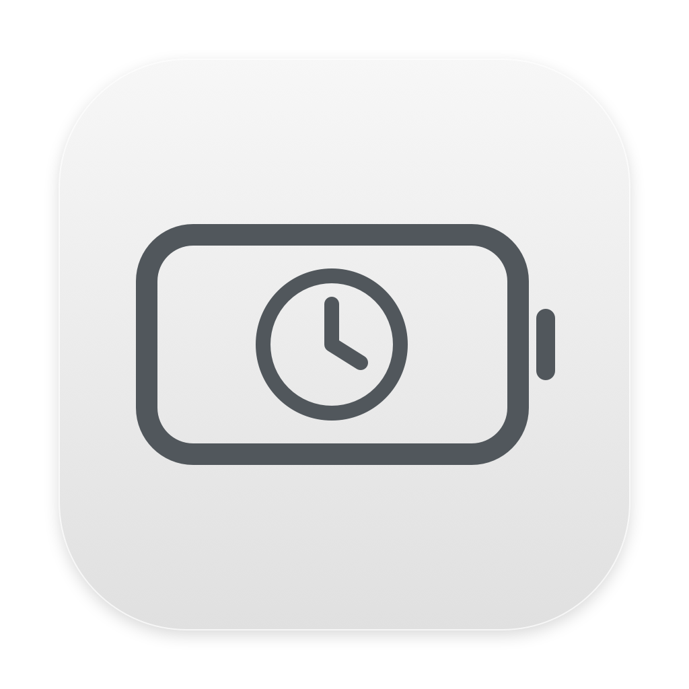

<p align="center">
  
</p>

# Battery Time

一个轻量、原生的 macOS 菜单栏应用，随时查看电池剩余时间。

[English](README.md) · [下载](https://github.com/ygyleo/mac-battery-remaining-time/releases/latest)

## 功能

- 菜单栏显示电池图标和预计剩余时间。
- 电池图标接近系统样式：平时跟随系统黑白色，电量不高于 20% 时黄色，不高于 10% 时红色，接通电源时显示插头。
- 点击打开原生菜单，上下两行显示电池剩余电量和剩余时间。
- 设置只有两项：中文 / English，以及登录时启动。登录时启动默认关闭。

**系统要求：** Apple Silicon（M 系列芯片）Mac，macOS 13 Ventura 或更新版本。不支持 Intel Mac。没有内置电池的 Mac 会显示不可用状态。

## 安装

1. 从 [Releases](https://github.com/ygyleo/mac-battery-remaining-time/releases) 下载 `Battery-Time-1.0.0-arm64.dmg`。
2. 打开 DMG，将 **Battery Time** 拖到 **Applications（应用程序）**。
3. 从应用程序文件夹启动。应用只出现在菜单栏，不显示 Dock 图标。

当前版本采用本地 ad hoc 签名，**尚未经过 Apple 公证**。如果 macOS 阻止首次启动，请前往 **系统设置 → 隐私与安全性**，在 Battery Time 的拦截提示旁选择 **仍要打开**，并确认你信任下载的应用。也可以自行从源码构建。

## 关于剩余时间

预计时间由 macOS 提供，会随当前负载变化。刚启动、睡眠唤醒或拔掉充电器后，系统可能暂时无法给出估算，此时应用会显示“估算中”或不可用状态，不会编造剩余时间。

充电时显示的是**距离充满的时间**。充满或接电但未充电时，会显示相应状态。切换语言立即生效并保存；启用登录时启动后，macOS 可能要求在“登录项”中批准。

## 从源码构建

先安装 Xcode 和 [XcodeGen](https://github.com/yonaskolb/XcodeGen)，然后运行：

```sh
git clone https://github.com/ygyleo/mac-battery-remaining-time.git
cd mac-battery-remaining-time
swift test --scratch-path build/swift-tests
bash scripts/build-release.sh
bash scripts/package-dmg.sh
```

应用和 DMG 输出到 `dist/`，`SHA256SUMS.txt` 提供安装包校验值。使用 Xcode 开发时，先运行 `xcodegen generate`，再打开 `BatteryTime.xcodeproj`。

项目仅构建 `arm64`，使用 AppKit、SwiftUI、IOKit 和 ServiceManagement，没有第三方运行时依赖。发布脚本默认使用 ad hoc 签名；如需 Developer ID 签名和公证，需使用自己的 Apple Developer 凭据另行完成。

## 隐私

Battery Time 只读取本机电池信息，不联网、不收集分析数据，也不需要 API Key。应用仅保存语言偏好，登录时启动由 macOS 管理。

## 许可证

[MIT](LICENSE) © 2026 ygyleo。
